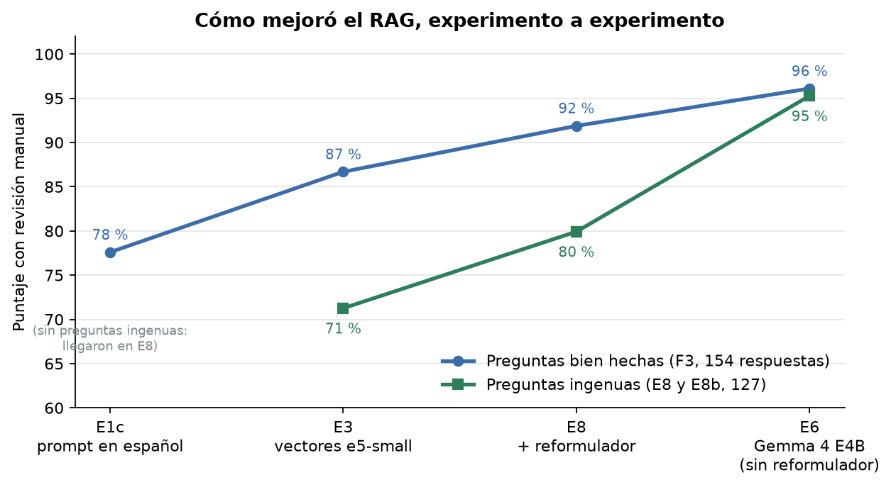
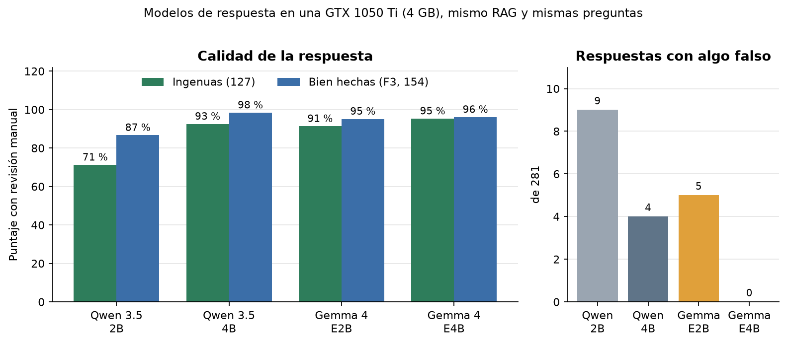
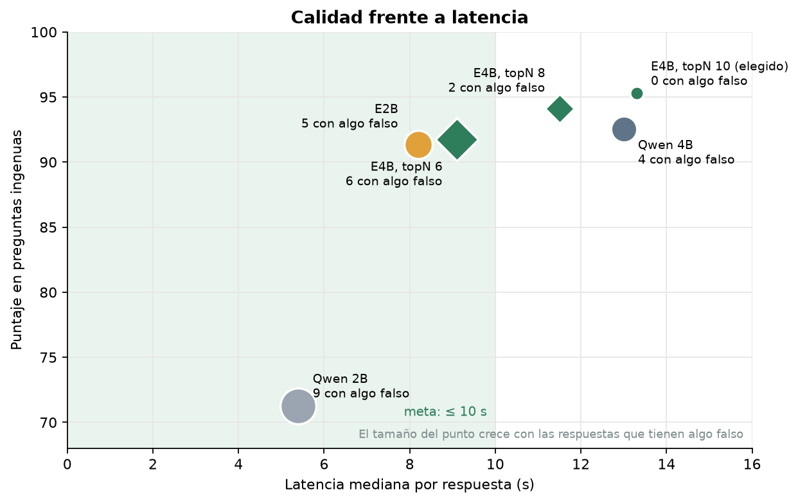

# rag-casero-1050ti

**Un RAG casero en español sobre una GTX 1050 Ti de 4 GB: cómo lo medimos, qué lo mejoró y un método para evaluar modelos nuevos.**

Un servidor doméstico con [AnythingLLM](https://github.com/Mintplex-Labs/anything-llm) y [Ollama](https://ollama.com) responde preguntas sobre los documentos de una familia. La pregunta era simple: **¿qué tan buenas son las respuestas de un modelo pequeño en una GPU de 4 GB, y qué las mejora?**

Para medirlo sin exponer documentos reales, armamos un **corpus ficticio** y un **banco de 163 preguntas** con su respuesta esperada. **Cada respuesta con cifras se revisó a mano**: el puntaje automático no detecta una cifra falsa acompañada de la cita correcta.

Cada experimento cambió una sola cosa y lleva un código (E0, E1…). El gráfico muestra los que se quedaron, en orden:

- **E1c, prompt en español:** el prompt del sistema de fábrica, en inglés, se cambió por uno en español con reglas: responder solo con lo que dicen los documentos, decir «No encontré» si el dato no está y copiar las cifras tal cual. Además, temperatura 0,2.
- **E3, vectores e5-small:** el modelo que convierte documentos y preguntas en vectores para buscar pasó de `all-MiniLM-L6-v2`, entrenado en inglés, a `multilingual-e5-small`. El fragmento con el dato pasó a llegar al modelo casi siempre.
- **E8, reformulador:** antes de buscar, un modelo más grande (Qwen 3.6 35B, en otro PC) reescribía la pregunta con las palabras de los documentos. Ayudó al modelo pequeño con las preguntas vagas.
- **E6, Gemma 4 E4B:** se cambió el modelo que responde, de Qwen 3.5 2B a Gemma 4 E4B, que cabe entero en los 4 GB. Con él, el reformulador ya no ayudaba y se desactivó.

Las preguntas **bien hechas** nombran el documento y usan sus palabras; las **ingenuas** están escritas como se escribe en Telegram («multa?»). El detalle de todos los experimentos está en [docs/RESULTADOS.md](docs/RESULTADOS.md).



## El resultado

| Configuración | Preguntas ingenuas (127) | Bien hechas (154) | Respuestas con algo falso | Latencia mediana |
|---|---|---|---|---|
| Al empezar: Qwen 3.5 2B, prompt original en inglés, vectores `all-MiniLM-L6-v2` | — | ~70 % | 7 de 178 | 6 s |
| Qwen 3.5 2B, prompt en español y vectores `multilingual-e5-small` | 71 % | 87 % | 9 | **5,4 s** |
| **Gemma 4 E4B «solo texto», 100 % en la GPU (configuración final)** | **95 %** | **96 %** | **0** | 13,3 s |

*Preguntas ingenuas: escritas como se escribe en Telegram («multa?», «cumplimos la meta de azufre?»). Bien hechas: con el nombre del documento y las palabras exactas. Puntaje con revisión manual: correcta = 2, parcial = 1, el resto = 0.*



## Lo que aprendimos

1. **Primero, que el dato llegue al modelo.** El modelo de vectores de fábrica (`all-MiniLM-L6-v2`, entrenado en inglés) dejaba fuera el dato en el 14–29 % de las preguntas, y en las presentaciones hasta en el 35 %. Con `multilingual-e5-small`, que AnythingLLM ya trae, el dato llega el 99–100 % de las veces. Ningún ajuste de topN ni de umbral lo había logrado. [→ E2 y E3](docs/RESULTADOS.md#e3-modelo-de-vectores-multilingüe)
2. **Un modelo de 7,5 B cabe en 4 GB si se le quita el proyector de visión.** Gemma 4 E4B (Q4_K_M) ocupa 3,7 GB con 16k de contexto y corre entero en la GPU. [→ variante «solo texto»](docs/METODO.md#2-preparar-el-modelo-candidato)
3. **El modelo de respuesta decide la calidad con preguntas vagas.** Con el dato delante, el 2B responde «No encontré» ante «multa?»; Gemma 4 E4B lo entiende (71 % → 95 %) y no dio ninguna respuesta falsa en 281.
4. **La latencia está en leer el contexto, no en generar.** AnythingLLM envía ~3.400 tokens; el E4B los lee a ~290 tok/s (~12 s). Bajar el topN a 6 u 8 acelera, pero vuelven las respuestas falsas. [→ topN](docs/RESULTADOS.md#e6d-y-e6e-menos-fragmentos)
5. **Reformular la pregunta con un modelo grande ayudó al 2B y empeora a Gemma** (95 % → 89 %): el reformulador lleva algunas preguntas al documento equivocado. [→ E6f](docs/RESULTADOS.md#e6f-gemma-con-el-reformulador)
6. **El puntaje automático engaña.** Un prompt que «mejoraba» 4 puntos en automático duplicaba las respuestas con contenido falso en la revisión manual. [→ criterios](docs/CRITERIOS_REVISION.md)
7. **Las instrucciones dentro de la pregunta empeoran** («si no aparece, dilo; copia la frase»): de 75 % a 63 %. Van en el prompt del sistema, no en la pregunta.
8. **Ojo con el historial de la API de AnythingLLM.** Si no se envía `sessionId`, cada pregunta arrastra las últimas consultas hechas por la API en ese espacio: el prompt pasaba de 3.400 a 6.000–7.000 tokens y la respuesta, de 16 a 30–43 s.



## Documentación

| Documento | Qué tiene |
|---|---|
| [docs/METODO.md](docs/METODO.md) | **Paso a paso para evaluar un modelo nuevo** con este mismo banco de pruebas |
| [docs/RESULTADOS.md](docs/RESULTADOS.md) | Todos los experimentos, en orden, con sus cifras y gráficos |
| [docs/CRITERIOS_REVISION.md](docs/CRITERIOS_REVISION.md) | Cómo se revisa a mano cada respuesta (veredictos y reglas) |
| [docs/ARQUITECTURA.md](docs/ARQUITECTURA.md) | Cómo está armado el RAG y su configuración final |
| [docs/CORPUS_Y_PREGUNTAS.md](docs/CORPUS_Y_PREGUNTAS.md) | El corpus ficticio y el banco de preguntas |
| [docs/GUIA_PREGUNTAS.md](docs/GUIA_PREGUNTAS.md) | Cómo preguntarle a un RAG con un modelo pequeño |

## Qué hay en el repositorio

```
corpus/          documentos ficticios (Word, PowerPoint, PDF digital y escaneado, notas de Obsidian)
preguntas/       banco de 163 preguntas con respuesta esperada (preguntas.json y .csv)
herramientas/    evaluación, revisión, comparación, gráficos y generación del corpus (Python)
experimentos/    cada cambio probado: prompts, configuraciones, preguntas reformuladas, scripts
resultados/      corridas (respuestas, búsquedas y revisiones manuales) y tablas de métricas
docs/            documentación y gráficos
```

## Cómo empezar

Requisitos: AnythingLLM (probado con 1.17) con Ollama como proveedor, una clave de API de AnythingLLM y Python 3. `rag_eval.py` y las demás herramientas de medición usan solo la biblioteca estándar.

```bash
git clone https://github.com/rodrigoabel/rag-casero-1050ti.git
cd rag-casero-1050ti
export ANYTHINGLLM_URL=http://<servidor>:3001/api/v1
export ANYTHINGLLM_API_KEY=<tu clave>        # o guárdala en ~/.config/prueba_rag/api_key (chmod 600)
python3 herramientas/rag_eval.py estado      # comprueba la conexión y muestra los espacios
```

Después, sube los 8 documentos de `corpus/usuario1/Mi_RAG/` a un espacio llamado `rag-eval` y sigue [docs/METODO.md](docs/METODO.md).

Para regenerar el corpus o los gráficos:

```bash
python3 -m venv .venv && .venv/bin/pip install -r herramientas/requirements.txt
.venv/bin/python herramientas/generar_corpus.py   # corpus/ y preguntas/
.venv/bin/python herramientas/graficos.py         # docs/graficos/ y resultados/tablas/metricas.csv
```

## Equipo

| | |
|---|---|
| GPU | NVIDIA GTX 1050 Ti, 4 GB |
| CPU y RAM | Intel i5-6400 (4 núcleos), 15 GB |
| Software | Ubuntu, AnythingLLM 1.17 (Docker), Ollama 0.40 (usa `llama-server` de llama.cpp por dentro) |
| Modelo de vectores y reordenador | `multilingual-e5-small` y `ms-marco-MiniLM-L-6-v2`, en la CPU, dentro de AnythingLLM |

## Privacidad

Todo lo publicado sale del corpus ficticio y del espacio de pruebas `rag-eval`, que solo contiene esos 8 documentos. Las primeras pruebas (línea base, E0 y E1) se hicieron en un espacio que también tenía documentos personales: de ellas se informan solo las cifras de resumen, sin las respuestas. Las direcciones, los nombres de usuario y los datos del servidor están anonimizados (`<servidor>`, `<pc>`, `usuario1`, `usuario2`).

## Licencia

[MIT](LICENSE)
