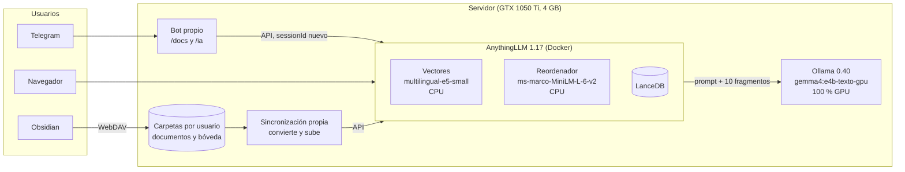

# Arquitectura y configuración final

## Cómo está armado



- **Cada persona tiene sus carpetas** (documentos y bóveda de Obsidian) y **sus espacios** en AnythingLLM, en modo multiusuario. Un servicio propio vigila las carpetas, convierte Word y PowerPoint con MarkItDown y los PDF con PyMuPDF4LLM (con OCR para los escaneados), sube el texto por la API y lo asigna al espacio de su dueño. Las notas de Obsidian llegan por WebDAV.
- **Un bot de Telegram propio** pregunta a AnythingLLM por la API: `/docs` en el espacio de documentos de la persona y `/ia` en el de sus notas.
- **La GPU es solo para el modelo de respuesta.** El modelo de vectores y el reordenador corren en la CPU, dentro de AnythingLLM.

## AnythingLLM

**Global:**

| Ajuste | Valor |
|---|---|
| Proveedor del modelo | Ollama, `gemma4:e4b-texto-gpu` (`OllamaLLMModelPref`) |
| Mantener el modelo cargado | 300 s |
| Modelo de vectores | `multilingual-e5-small` (motor nativo, en la CPU) |
| Base de vectores | LanceDB |
| Troceo | 1.000 caracteres, 20 de solapamiento |

**Por espacio:**

| Ajuste | Espacios de documentos | Espacios de notas de Obsidian |
|---|---|---|
| Modo | `query` | `query` |
| Prompt del sistema | `experimentos/E1c_prompt_sistema_es.txt` | ídem |
| Temperatura | 0,2 | 0,2 |
| Mensaje de rechazo | `experimentos/E1_respuesta_rechazo_es.txt` | ídem |
| topN | **10** | **4** |
| Umbral de similitud | 0,2 | 0,25 |
| Búsqueda | `rerank` | sin reordenador |
| Modelo fijo (`chatModel`) | ninguno: usa el global | ninguno |
| Latencia típica | 13–21 s | 4–7 s |

- **La regla de topN:** las notas son cortas y usan las mismas palabras que las preguntas (100 % en todas las pruebas), así que 4 fragmentos bastan. En los documentos largos, menos de 10 fragmentos trajo respuestas falsas ([E6d y E6e](RESULTADOS.md#e6d-y-e6e-menos-fragmentos)).
- **Los espacios nuevos nacen con la configuración de fábrica** (prompt en inglés, sin temperatura, topN 4, sin reordenador). Hay que aplicarles esta, por ejemplo con `rag_config.py aplicar` y las plantillas `experimentos/PROD_usuario2_espacio.json` (documentos) y `PROD_usuario2_notas.json` (notas).
- **Todos los espacios usan el mismo modelo:** dos modelos de respuesta no caben juntos en 4 GB, y Ollama descargaría uno para cargar el otro en cada cambio.
- **El razonamiento («thinking») está apagado:** un parche local en el contenedor (en `reasoningEffort.js`) hace que AnythingLLM envíe `think: false` a Ollama; con Gemma 4 E4B se comprobó que responde sin razonar (~25 tokens). Si se actualiza la imagen, el parche se pierde y las respuestas pueden volverse lentas o traer el razonamiento.

## Ollama y el modelo

`gemma4:e4b-texto-gpu` es `gemma4:e4b` (Gemma 4 E4B, 7,5 B parámetros, Q4_K_M) sin el proyector de visión y audio y con todas las capas en la GPU:

```bash
ollama pull gemma4:e4b
bash experimentos/crear_variante_texto.sh gemma4:e4b gemma4:e4b-texto-gpu --gpu
```

| | |
|---|---|
| Capas en la GPU | 43/43 |
| VRAM | 3,7 GB de 4 (con 16.384 tokens de contexto, el que pide AnythingLLM) |
| «Embeddings por capa» (PLE) | ~3 GB, en la RAM |
| Lectura del contexto / generación | ~290 tok/s / ~42 tok/s (con su modelo borrador) |
| Ollama por dentro | `llama-server` de llama.cpp con `-c 16384 -b 512 -ub 512 --flash-attn auto` |

**Riesgos:**
1. **VRAM al límite.** Con `num_gpu 99`, si otro proceso usa la GPU, la carga falla en vez de repartirse. Plan B: la variante sin `--gpu` (36/43 capas en la GPU, ~1 s más por respuesta).
2. **El contexto:** si AnythingLLM pidiera más de 16.384 tokens, el modelo dejaría de caber.
3. **Gemma lee los metadatos del fragmento** (por ejemplo, la fecha de carga del archivo) como si fueran contenido.

## El bot y el historial de la API

**El problema:** la API de chat de AnythingLLM (`POST /v1/workspace/<slug>/chat`) acepta un `sessionId`. **Si no se envía, AnythingLLM agrega al prompt las últimas consultas hechas por la API en ese espacio** (hasta `openAiHistory`, 20 mensajes), de cualquier usuario del bot.

Con el 2B (que lee ~850 tok/s) casi no se notaba. Con Gemma 4 E4B (~290 tok/s):

| | Sin `sessionId` | Con un `sessionId` nuevo por pregunta |
|---|---|---|
| Tokens del prompt (misma pregunta) | 5.970–7.067 | ~3.450 |
| Respuesta de `/docs` | 30–43 s | 15–21 s |

Además, las conversaciones anteriores pueden mezclarse con la respuesta, y las de una persona entran en el prompt de otra si comparten un espacio.

**La solución:** el bot envía `"sessionId": "telegram-<marca de tiempo>"` en cada pregunta, igual que `rag_eval.py` en las pruebas. El bot no recuerda la pregunta anterior: «¿y el caché?» después de otra pregunta no funciona, pero tampoco funcionaba antes, porque **la búsqueda nunca usa el historial**, solo el mensaje actual.

**Otros ajustes del bot:**
- Espera hasta 120 s la respuesta (antes, 50 s: una pregunta amplia o la primera del día con Gemma podía pasarse).
- Sin reformulador ([E6f](RESULTADOS.md#e6f-gemma-con-el-reformulador)): busca la pregunta tal cual.
- Muestra las fuentes consultadas con cada respuesta.

## Equipo

| | |
|---|---|
| GPU | NVIDIA GTX 1050 Ti, 4 GB |
| CPU | Intel i5-6400 (4 núcleos) |
| RAM | 15 GB |
| Sistema | Ubuntu, Docker |
