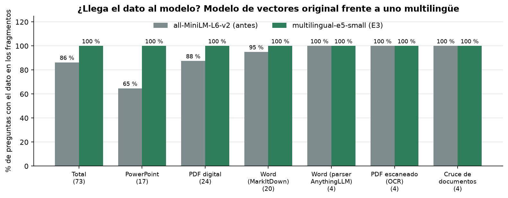
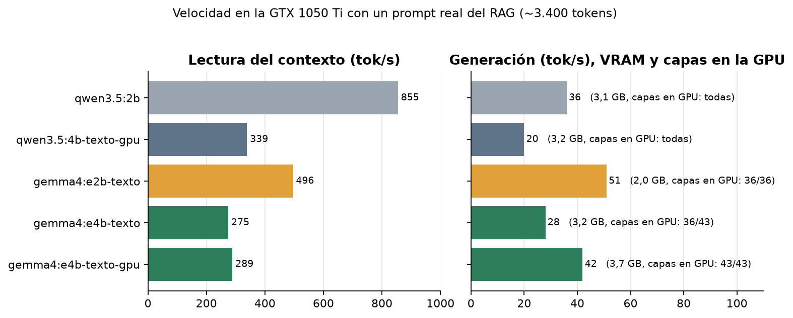
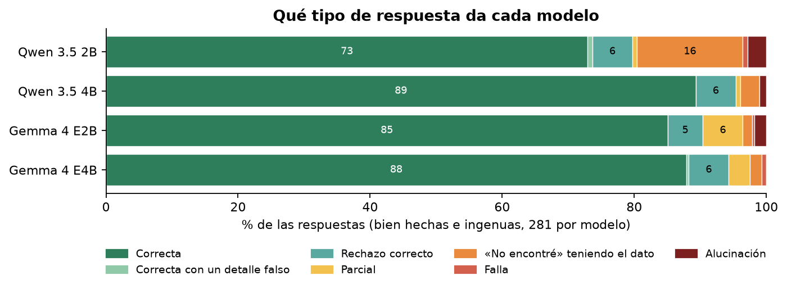
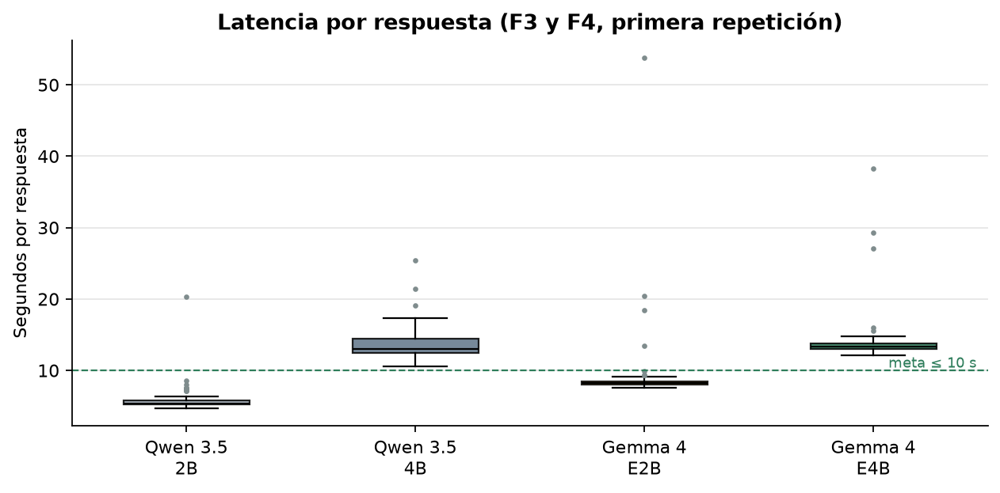
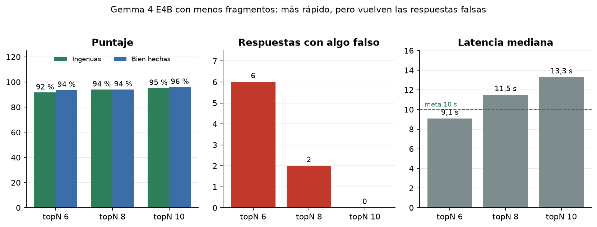
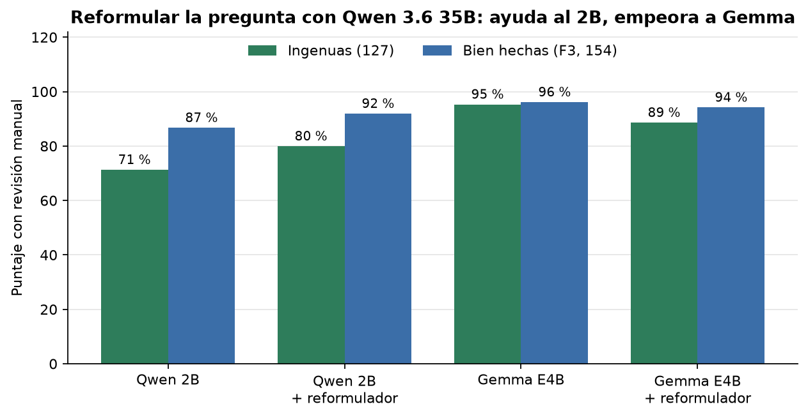

# Resultados

Los experimentos, en el orden en que se hicieron (9 y 10 de octubre de 2026). Cada uno cambió **una sola cosa** respecto del anterior, con respaldo previo, y se midió con el mismo banco de preguntas y revisión manual ([criterios](CRITERIOS_REVISION.md)).

**Cómo leer las cifras:**
- **Puntaje** = correcta 2 puntos, parcial o con ruido 1, el resto 0, sobre el máximo posible. Siempre con la revisión manual.
- **Bien hechas (F3):** 77 preguntas × 2 repeticiones = 154 respuestas. **Ingenuas:** 41 de E8 y F4 × 2, más 15 de E8b × 3 = 127 respuestas.
- Desde E2b se cuentan **solo las respuestas del espacio `rag-eval`**, que tiene únicamente el corpus ficticio. Los análisis originales sumaban además 24 respuestas sobre notas de Obsidian (178 en la F3), así que algunas cifras difieren en 1–2 puntos de las que se usaron al decidir.
- Las primeras pruebas (línea base, E0, E1 y E2) se hicieron en el espacio principal, que también tenía documentos personales. De ellas se informan solo las cifras de resumen.

## Resumen

| Experimento | Qué se probó | Resultado | Decisión |
|---|---|---|---|
| Línea base | Configuración de fábrica con Qwen 3.5 2B | Bien hechas 70 %; el dato llega al modelo el 71 % de las veces | — |
| [E0](#e0-instrucciones-dentro-de-la-pregunta) | «Si no aparece, dilo; copia la frase» al final de la pregunta | 75 % → 63 % | Descartado |
| [E1](#e1-prompt-del-sistema-en-español) | Prompt del sistema en español con reglas, temperatura 0,2 | Igual puntaje, pero estable, en español y sin respuestas confusas | **E1c aplicado** |
| [E2](#e2-topn-umbral-y-reordenador) | topN, umbral y reordenador (simulado) | Casi no influyen: el techo lo pone la búsqueda | Sin cambios |
| [E2b](#e2b-un-espacio-solo-para-medir) | Espacio `rag-eval` solo con el corpus | El dato llega 87 %; bien hechas 78 % | Se mide ahí desde entonces |
| [E3](#e3-modelo-de-vectores-multilingüe) | Vectores `multilingual-e5-small` | El dato llega 86 % → **100 %**; bien hechas 78 % → 87 % | **Aplicado** |
| [E9](#e9-un-modelo-de-vectores-más-grande) | `Qwen3-VL-Embedding-2B` (simulado) | Igual que e5-small y no cabe junto al modelo | Descartado |
| [E8](#e8-reformular-la-pregunta) | Reformular la pregunta con Qwen 3.6 35B y un mapa de temas | Ingenuas 71 % → 80 %; bien hechas 87 % → 92 % | Aplicado (luego retirado) |
| [E6](#e6-modelos-de-respuesta) | Qwen 3.5 4B, Gemma 4 E2B y Gemma 4 E4B | **E4B: ingenuas 95 %, bien hechas 96 %, 0 falsas, 13 s** | **E4B aplicado** |
| [E6d y E6e](#e6d-y-e6e-menos-fragmentos) | E4B con topN 6 y 8 | 9,1 s y 11,5 s, pero 6 y 2 respuestas falsas | Se queda topN 10 |
| [`num_batch`](#num_batch-1024) | Lotes de 1.024 al leer el contexto | No acelera | Descartado |
| [E6f](#e6f-gemma-con-el-reformulador) | E4B con el reformulador de E8 | Ingenuas 95 % → 89 % | **Reformulador desactivado** |

## Línea base

Configuración de fábrica de AnythingLLM 1.17 con `qwen3.5:2b` (Q8_0): prompt del sistema genérico en inglés, sin temperatura definida (Ollama usa la del modelo, 1,0), modelo de vectores `all-MiniLM-L6-v2`, topN 10 con reordenador.

- **Bien hechas: 70 %** (178 respuestas). Formulación (F4): 47 %.
- **El dato exacto llegó al modelo el 71 % de las veces.** El 80 % de los fallos fueron de búsqueda, no del modelo.
- **7 respuestas falsas con la cita correcta (4 %)**: el hallazgo H15, que obligó a revisar todo a mano.
- Por formato: notas de Obsidian 100 %, Word 84 %, PDF escaneado 75 %, PDF digital 62 %, **PowerPoint 47 %**.
- Latencia: mediana 6,2 s, p95 12,7 s.

## E0: instrucciones dentro de la pregunta

Se agregó al final de cada pregunta: «Si no aparece, dilo. Copia la frase del documento que lo respalda.»

- **El puntaje bajó de 75 % a 63 %** (subconjunto rápido, 26 preguntas × 2).
- La instrucción también entra en la búsqueda (en modo `query`, AnythingLLM busca con el mensaje completo) y la empeora: el dato llega 65 % en vez de 70 %.
- El modelo de 2B dice «no aparece» aunque tenga el dato, y a veces se contradice: «no aparece… 14 supervisores».

**Lección:** las instrucciones van en el prompt del sistema, no en la pregunta.

## E1: prompt del sistema en español

Cinco variantes (`experimentos/E1*_prompt_sistema_es.txt`), con temperatura 0,2 y un mensaje de rechazo en español. La aplicada, **E1c**, tiene 7 reglas: responder solo con el contexto, decir «No encontré esa información en los documentos» si no está, comprobar que la cifra corresponde al mismo indicador, período y unidad de la pregunta, copiar cifras tal cual, preferir el valor vigente y corregir premisas falsas.

| | Línea base | E1a (E1c es E1a ajustado) |
|---|---|---|
| Puntaje (subconjunto rápido) | 75 % | 76 % |
| Respuestas confusas | 5 | **0** |
| Respuestas en inglés | 1 | **0** |
| Preguntas que cambian de veredicto entre repeticiones | 3 | **1** |
| Largo mediano / latencia mediana | 224 car. / 5,8 s | **107 car. / 4,5 s** |

- El puntaje casi no cambia: **el problema principal seguía en la búsqueda**.
- **E1b** (pedir que copie la frase que respalda la respuesta): citas reales en el 93 % de los casos, pero 71 %.
- **E1e** (respuestas en frase completa): el automático sube 4 puntos, pero **la revisión manual encuentra el doble de contenido falso** (de 5 a 11). Al escribir más, el modelo agrega cosas: invierte un límite de seguridad («al menos 2 personas», cuando es «como máximo 2»).

## E2: topN, umbral y reordenador

Se midió sin el modelo: una sola búsqueda con 50 candidatos por pregunta y `herramientas/simular_busqueda.py`, que reproduce exactamente la búsqueda de AnythingLLM 1.17 para cualquier combinación.

**Cómo busca AnythingLLM 1.17** (`utils/vectorDbProviders/lance`):
1. Toma como candidatos el **10 % de los fragmentos del espacio** (mínimo 10, máximo 50), los más parecidos por vector. No se puede configurar.
2. El reordenador (`ms-marco-MiniLM-L-6-v2`) los ordena y se queda con los topN primeros.
3. Descarta los de similitud menor que el umbral.

| topN \ umbral | 0 | 0,1 | 0,2 | 0,3 |
|---|---|---|---|---|
| 4 | 67 % | 67 % | 66 % | 66 % |
| 6 | 69 % | 69 % | 67 % | 67 % |
| 10 | 69 % | 69 % | 67 % | 67 % |
| 20 | 69 % | 69 % | 67 % | 67 % |

*% de preguntas en que el dato exacto llega al modelo (espacio principal, 239 fragmentos).*

- **Techo de 69 %:** en 28 de 89 preguntas el fragmento con el dato no estaba entre los candidatos. Cuando sí estaba, el reordenador lo dejaba entre los 4 primeros en 60 de 61 casos.
- **H14: un documento grande ajeno acapara la búsqueda.** Un reglamento de 163 KB, sin relación con las preguntas, ocupaba el 76 % de los puestos de candidatos (84 % en las búsquedas fallidas). **Conviene un espacio por tema o por persona.**

## E2b: un espacio solo para medir

Para que H14 no falsee las mediciones, se creó `rag-eval` con solo los 8 documentos del corpus (27 fragmentos) y la misma configuración (`herramientas/workspace_pruebas.py`). Desde aquí, todas las mediciones son en `rag-eval`.

- El dato llega el **87 %** de las veces (frente a 71 % en el espacio principal).
- Bien hechas: **78 %**. Latencia mediana: 3,7 s.

## E3: modelo de vectores multilingüe

`all-MiniLM-L6-v2` está entrenado para inglés, y los documentos y las preguntas son en español. AnythingLLM trae de serie `multilingual-e5-small` (118 M de parámetros, en la CPU). Antes de cambiarlo, `herramientas/simular_embedder.py` predijo en el PC que el dato llegaría el 99 % de las veces.

| | MiniLM | **e5-small** |
|---|---|---|
| El dato llega (`rag-eval`, 73 preguntas con dato) | 86 % | **100 %** |
| El dato llega (espacio principal) | 71 % | **99 %** |
| PowerPoint (`rag-eval`) | 65 % | **100 %** |
| Bien hechas, Qwen 3.5 2B (`rag-eval`) | 78 % | **87 %** |
| Latencia de la búsqueda | 0,67 s | 0,68 s |

- **Lo que quedó después de E3 ya no era búsqueda:** eran errores del modelo al leer tablas, calcular y entender preguntas vagas.
- **Cuidado al cambiarlo:** en AnythingLLM 1.17, cambiar el modelo de vectores borra las asignaciones de documentos de **todos** los espacios. `herramientas/cambiar_embedder.py` guarda un inventario, cambia el modelo y vuelve a asignar todo (los documentos estuvieron fuera ~1–2 min).
- En el espacio principal, el reglamento grande pasó de ocupar el 59 % al 27 % de lo que lee el modelo.

## E9: un modelo de vectores más grande

`Qwen3-VL-Embedding-2B`, simulado en el PC con 133 preguntas: **el mismo 97 % que e5-small** en el espacio principal y el mismo orden de resultados. No lo admite el motor nativo de AnythingLLM, tendría que servirse por Ollama (sin la instrucción que el modelo espera) y no cabe en la GPU junto al modelo de respuesta. Descartado.

## E8: reformular la pregunta

Con E3 la búsqueda ya funcionaba también con preguntas ingenuas (el dato llegaba el 95–98 % de las veces), pero **el 2B las respondía mal**: ante «multa?» o «¿quién es Tomás?» decía «No encontré» con el párrafo delante.

La idea: antes de buscar, otro modelo reescribe la pregunta con las reglas de [GUIA_PREGUNTAS.md](GUIA_PREGUNTAS.md) y un **mapa de temas** del espacio (título y secciones de cada documento, sin cifras; `experimentos/E8_mapa_*.md`). Se probó con `herramientas/reformular.py` y `rag_eval.py --reformuladas`.

| Reformulador | Ingenuas E8 (82) | Ingenuas E8b (45) | Bien hechas (154) | Con algo falso |
|---|---|---|---|---|
| Ninguno (Qwen 3.5 2B responde) | 66 % | 80 % | 87 % | 9 |
| Qwen 3.5 2B, sin mapa | 66 % | — | — | — |
| Qwen 3.5 2B, con mapa | 55 % | — | — | — |
| Qwen 3.6 35B-A3B, sin mapa | 70 % | — | — | — |
| **Qwen 3.6 35B-A3B, con mapa, reglas v1** | **76 %** | **87 %** | **92 %** | **8** |
| Qwen 3.6 35B-A3B, con mapa, reglas v2 | 79 % | 83 % | 90 % | 12 |
| Qwen 3.6 35B-A3B, con mapa, reglas v3 | 74 % | 80 % | 89 % | 12 |
| Qwen 3.8 27B, con mapa | 79 % | 87 % | 86 % | 13 |
| Qwen 3.6 35B-A3B, mapa automático | 79 % | 63 % | 87 % | 12 |

- **Ruido:** la misma corrida sin reformular, repetida 5 veces, dio 66–69 % (67 ± 1 %).
- **Hace falta un modelo grande y el mapa.** Con el 2B como reformulador empeora.
- **El mapa automático** (títulos y secciones extraídos de los documentos) acierta con las preguntas que se usaron al diseñarlo, pero cae al 63 % con preguntas nuevas (E8b). Por eso E8b existe: **15 preguntas escritas después de ajustar**, para detectar el sobreajuste.
- **Se aplicó la v1 en el bot** (reformular siempre, mostrando «🔎 Busqué: …»). Necesitaba el PC encendido con el modelo de 35B. Una simulación de **reformular solo cuando la respuesta es «No encontré»** daba 88 % en las ingenuas.

## E6: modelos de respuesta

¿Cabe en la GTX 1050 Ti algo mejor que el 2B? Se probaron Qwen 3.5 4B, Gemma 4 E2B y Gemma 4 E4B (Q4_K_M), con el [método](METODO.md) completo.

**Hacerlos caber:** los cuatro traen un proyector de visión (Gemma, también de audio) de hasta ~1 GB que Ollama carga aunque solo se use texto, y el ajuste automático de Ollama deja ~1 GB libre. La solución fue una **variante «solo texto»** (el Modelfile sin la segunda línea `FROM`) y, cuando hace falta, **`PARAMETER num_gpu 99`** (`experimentos/crear_variante_texto.sh`).

- **Gemma 4 E4B cabe entero (43/43 capas, 3,7 GB con 16k de contexto)**, porque guarda en la RAM sus «embeddings por capa» (~3 GB), que no necesitan la GPU.
- **Gemma genera rápido gracias a su modelo borrador** (decodificación especulativa, que Ollama trae activada): 42 tok/s frente a 20 del Qwen 4B.
- **Lo que limita la latencia es la lectura del contexto:** AnythingLLM envía ~3.400 tokens (prompt y 10 fragmentos), y el 4B y el E4B los leen 2,5–3 veces más lento que el 2B.

| | Qwen 3.5 2B | Qwen 3.5 4B | Gemma 4 E2B | **Gemma 4 E4B** |
|---|---|---|---|---|
| Ingenuas (127) | 71 % | 92 % | 91 % | **95 %** |
| Bien hechas (154) | 87 % | **98 %** | 95 % | 96 % |
| «No encontré» teniendo el dato | 45 | 8 | **4** | 5 |
| Respuestas con algo falso | 9 | 4 | 5 | **0** |
| Rechaza lo que no está (8 preguntas) | 8/8 | 8/8 | 6/8 | 8/8 |
| Latencia mediana / p95 | **5,4 / 7,5 s** | 13,0 / 16,2 s | 8,2 / 9,4 s | 13,3 / 14,8 s |

**Los errores de cada uno** (lo que más pesó al decidir):
- **Qwen 3.5 4B** calcula y concluye, a veces mal: «82,2 %» (es 84,4 %); «Sí, se cumplió la meta de 96,5 %, ya que alcanzó el 95,8 %».
- **Gemma 4 E2B** inventa cuando el dato no está: a «¿cuál es el índice de rotación de personal?» (no existe en los documentos) responde con el índice de frecuencia de incidentes. También toma la fecha de carga del archivo como fecha del informe.
- **Gemma 4 E4B** no dio ninguna respuesta falsa. Sus errores son por omisión: no hace cuentas (da los datos sin el cálculo), no corrige una premisa falsa y a «¿cumplimos la meta?» da el valor y la meta sin decir «no».

**Decisión: Gemma 4 E4B.** Para quien cita un plazo de un contrato o reporta un parámetro de operación, una cifra falsa cuesta más que unos segundos de espera. Gemma 4 E2B sería la opción si la latencia importara más (8 s), aceptando que a veces inventa.

## E6d y E6e: menos fragmentos

Si lo que tarda es leer ~3.400 tokens, ¿y si se envían menos fragmentos?

| Gemma 4 E4B | topN 6 | topN 8 | **topN 10** |
|---|---|---|---|
| Ingenuas | 92 % | 94 % | **95 %** |
| Bien hechas | 94 % | 94 % | **96 %** |
| Respuestas con algo falso | 6 | 2 | **0** |
| Latencia mediana | **9,1 s** | 11,5 s | 13,3 s |

Con menos fragmentos se pierden los del informe jurídico que están en los puestos 7 a 9 (plazo de construcción, fecha de firma, 32 años), y vuelven las respuestas falsas: «¿cuánto tienen para terminar las obras?» → «vence en marzo de 2056». **Se queda topN 10.**

## `num_batch` 1024

Lotes más grandes al leer el contexto (`options.num_batch`, que fija `-b` y `-ub` de `llama-server`): 285–288 tok/s frente a 290–294 con 512, y 176 MiB más de VRAM. La GTX 1050 Ti ya está al máximo. Descartado.

## E6f: Gemma con el reformulador

El reformulador de E8 compensaba las debilidades del 2B. ¿Le sirve a Gemma? Se midió con **las mismas preguntas reformuladas** por Qwen 3.6 35B que se usaron con el 2B (guardadas en `experimentos/`), así que lo único que cambia es el modelo que responde.

| | Qwen 3.5 2B | 2B + reformulador | **Gemma 4 E4B** | E4B + reformulador |
|---|---|---|---|---|
| Ingenuas | 71 % | 80 % | **95 %** | 89 % |
| Bien hechas | 87 % | 92 % | **96 %** | 94 % |
| Respuestas con algo falso | 9 | 8 | **0** | 1 |

- **Con Gemma, reformular empeora:** el reformulador lleva algunas preguntas al documento equivocado («cuánto se guardan los logs de auditoría?» terminó en el procedimiento del horno, y la respuesta fue «5 años», cuando son 400 días) o las vuelve genéricas («ley de mata?» → «¿qué establece el procedimiento?»).
- **Reformular solo tras «No encontré»** (simulado con las mismas corridas): ingenuas ~98 %, +3 puntos (4 respuestas de 127). No justifica mantener encendido un PC con un modelo de 35B ni escribir los mapas a mano.
- **Se desactivó el reformulador.**

## En producción

| Cambio | Por qué |
|---|---|
| `multilingual-e5-small` para todos los espacios | E3 |
| Prompt E1c, temperatura 0,2 y rechazo en español en todos los espacios en uso | E1 |
| `gemma4:e4b-texto-gpu` como modelo global; ningún espacio con modelo fijo | E6: dos modelos de respuesta no caben juntos en 4 GB |
| **topN 4** sin reordenador en los espacios de notas de Obsidian de cada persona | Notas cortas: ~5 s |
| **topN 10** con reordenador en todos los demás espacios | E6d y E6e: máxima precisión, ~13–16 s |
| Reformulador desactivado | E6f |
| El bot envía un `sessionId` nuevo por pregunta | Sin él, el historial de la API entraba al prompt (ver [ARQUITECTURA.md](ARQUITECTURA.md#el-bot-y-el-historial-de-la-api)) |

**Latencia real por el bot:** `/docs` 15–21 s (espacio con 20 documentos: la búsqueda tarda ~3 s, porque el reordenador corre en la CPU y crece con el espacio), `/ia` sobre notas ~4–7 s, y ~20 s la primera pregunta con el modelo descargado.

## Lo que queda por probar

- **E4:** trozos de 600–800 caracteres con más solapamiento (hoy 1.000 y 20). Perdió prioridad porque la búsqueda ya llega al 99–100 %.
- **E5:** muestreo más conservador (`top_p`, penalizaciones) en el Modelfile.
- **E7:** contexto de 8.192 tokens en vez de 16.384 (menos memoria; no debería cambiar nada con topN 10).
- **F6 y F7:** actualización de documentos (que no queden versiones viejas) y aislamiento entre usuarios. Las preguntas ya están en el banco (`UPD-*` y `AIS-*`).
- **Modelos nuevos:** con el [método](METODO.md), cada uno cuesta ~1 h de corridas y una revisión.
